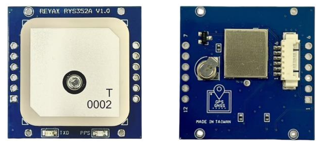
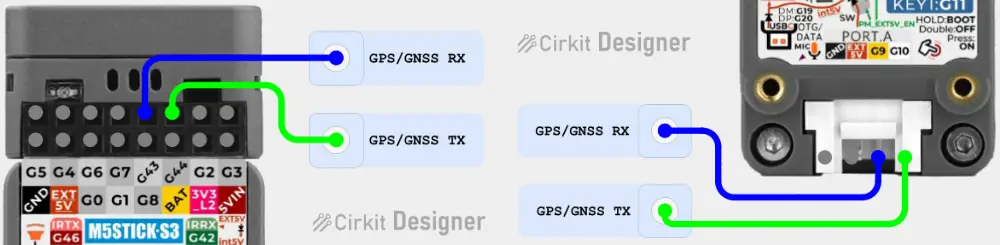
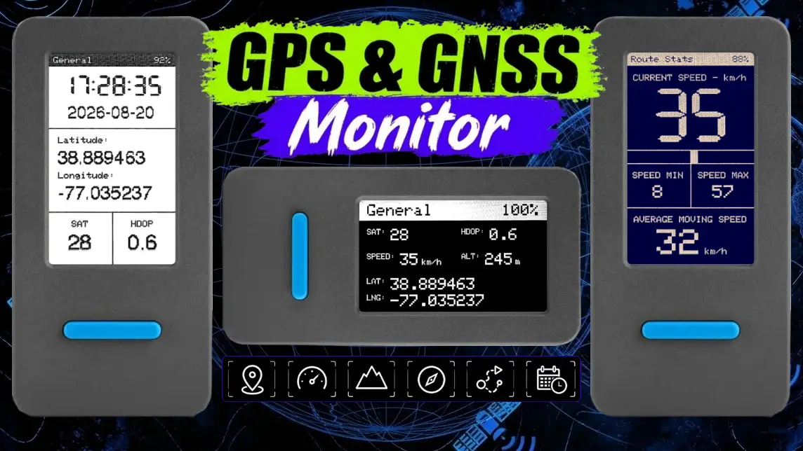
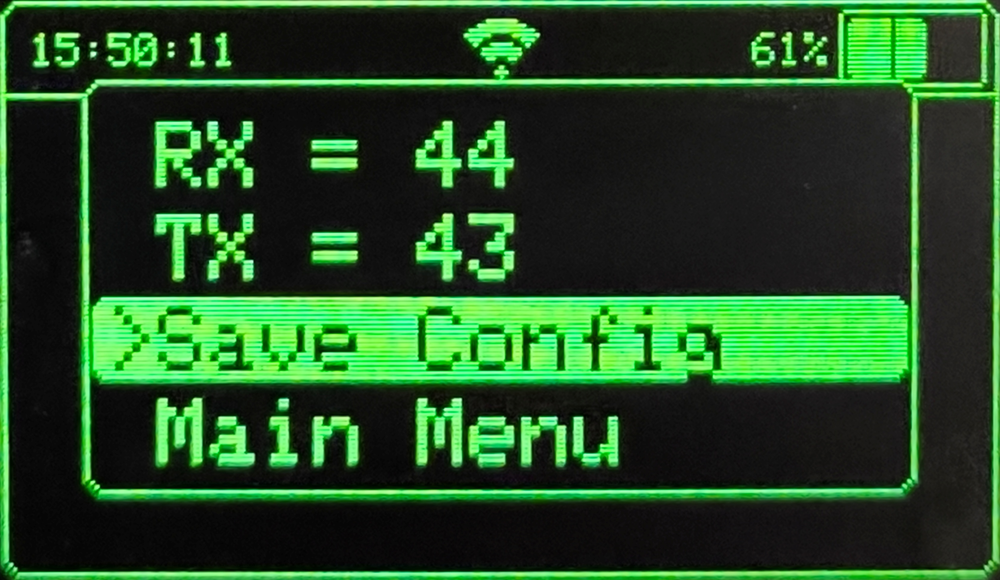
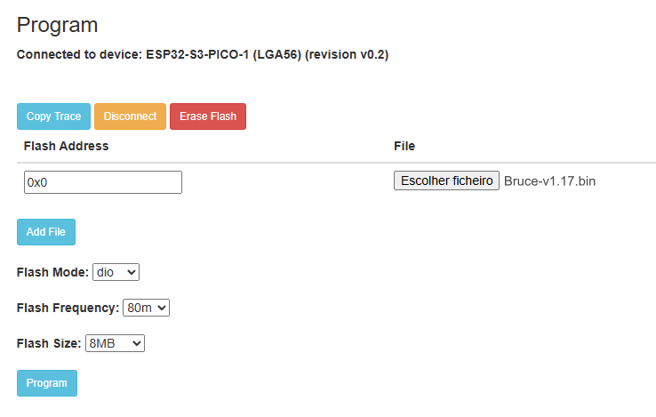
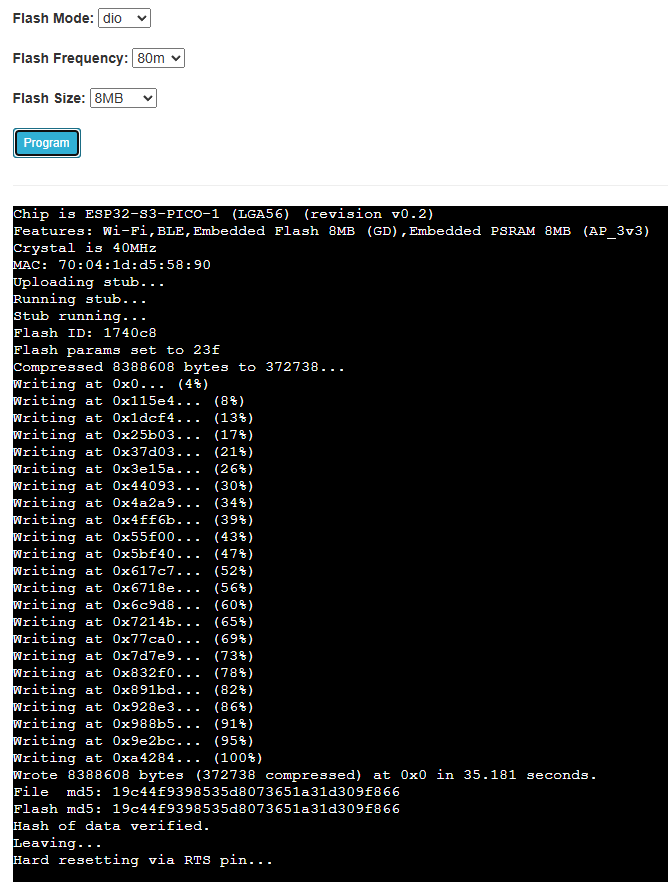

  

# StickS3 with GPS and GNSS

Turn your **M5StickS3** into a compact and practical GPS/GNSS device.

This project provides two firmware options for connecting a compatible GPS or GNSS module to the StickS3 and displaying positioning and satellite information directly on its screen.

The main goal is to make GPS/GNSS data easy to access in a portable device, whether for navigation, testing, field monitoring, development, or simply exploring positioning data.

## ✨ What This Project Provides

This repository includes:

* Compatible module requirements
* Instructions for connecting a GPS/GNSS module
* Hardware assembly information
* Configuration instructions
* Two firmware options for the StickS3
* Precompiled `.bin` firmware files
* Source code for **GPS & GNSS Monitor**
* Firmware installation instructions
* Basic usage instructions for both firmware options

The two firmware options are:

| Firmware               | Main Purpose                                                                                                                                                                                |
| ---------------------- | ------------------------------------------------------------------------------------------------------------------------------------------------------------------------------------------- |
| **GPS & GNSS Monitor** | Dedicated firmware for monitoring GPS/GNSS positioning, satellite, movement, distance, route, and time information                                                                          |
| **Bruce Modified**     | Bruce firmware with all its existing features, enhanced with a new **GPS Info** screen for viewing satellites, HDOP, course, speed, altitude, date, time, timezone, latitude, and longitude |

---

## 📡 GPS/GNSS Module Compatibility and Electrical Safety

### What makes a module compatible?

The firmware is designed for GPS/GNSS receivers that output standard **NMEA data over UART** and can be configured to use one of the supported baud rates. The firmware uses UART communication in `SERIAL_8N1` format: 8 data bits, no parity, and 1 stop bit.

A module is not guaranteed to work simply because it is described as a GPS or GNSS module. Before connecting one, check its documentation to confirm that it can output compatible NMEA data over UART, that its baud rate is supported, and that its voltage and logic levels are safe for the StickS3. Verify compatibility before testing an unfamiliar module.

The following are examples of GPS/GNSS modules that use UART and provide NMEA data: **RYS352A, NEO-6M, NEO-M8N, BN-220, ATGM336H, MAX-M10S, and M5Stack GPS modules**

> **⚠️ Important:** Before connecting a GPS/GNSS module to the StickS3, always check the module's datasheet and verify its **power supply voltage, UART logic levels, pinout, and communication settings**. Specifications may vary between manufacturers, module models, and breakout boards. Make sure that the module is electrically compatible with the StickS3 before connecting it.

### GPS versus GNSS

**GPS** is the satellite navigation system operated by the United States. **GNSS** is the broader term for Global Navigation Satellite Systems and can include GPS, Galileo, GLONASS, BeiDou, and other satellite constellations. A GNSS receiver that can use multiple constellations may be able to use more satellites in suitable conditions, but actual performance depends on the receiver, antenna, environment, and satellite visibility.

### Baud rates

The firmware offers these module baud rates:

`9600`, `19200`, `38400`, `57600`, `115200`

The selected rate must match the rate at which the module sends UART data. If the rates do not match, the StickS3 may receive unreadable data or no valid GPS/GNSS information. The baud rate selected in **Basic Settings** is the module communication rate; it is separate from the baud rate used by a computer when flashing the firmware.

### Voltage and UART logic-level safety

**Check voltage compatibility before connecting or powering the hardware.** The module's required supply voltage must be compatible with the voltage supplied by your chosen StickS3 connection (3.3 V or 5 V, depending on the connection and hardware specification). Do not assume that every module accepts either voltage.

Also check the module's UART signal levels, especially its **TX output**, which connects to the StickS3's RX input. The StickS3's GPIO logic is 3.3 V; the signal delivered to its GPIO must stay within the level supported by the StickS3. A module powered from 5 V may still output 5 V UART logic, which can damage the StickS3 if connected directly. Use a suitable level shifter or other properly designed interface if the module's TX signal is not 3.3 V-compatible.

Connect **GND to GND**, cross the UART signals correctly, and verify the module pinout before powering on:

- Module **TX → StickS3 RX**
- Module **RX ← StickS3 TX** (if the module requires receiving commands)
- Module **GND ↔ StickS3 GND**

The module's supply voltage and UART logic voltage are separate specifications; verify both in the module documentation.

### Accuracy and receiver quality

Different receivers, antennas, antenna placement, satellite visibility, signal strength, buildings, trees, reflections, atmospheric conditions, and other environmental factors can change fix acquisition time and the accuracy of position, speed, and altitude. The firmware displays and processes the information received from the receiver; it cannot create accuracy that the receiver's data does not provide.

For more reliable results, use a good-quality module and antenna, allow the receiver time to acquire a stable fix, and test in an environment with a clear view of the sky when possible.

### Recommended module: REYAX RYS352A

I used the **REYAX RYS352A** during development and testing and strongly recommend it based on my experience. In my tests, it provided excellent positioning quality and precision and acquired satellites quickly. Results can still vary with antenna placement, environment, and satellite conditions.

  

- **Official product page:** [reyax.com/product/GPS-GNSS/RYS352A](https://reyax.com/product/GPS-GNSS/RYS352A)
- **DigiKey:** [digikey.com/en/products/detail/reyax/RYS352A/22206992](https://www.digikey.com/en/products/detail/reyax/RYS352A/22206992)
- **eBay:** [ebay.com/itm/187031730034](https://www.ebay.com/itm/187031730034)
- **Amazon:** [amazon.com/dp/B0CM5JTJL7](https://www.amazon.com/dp/B0CM5JTJL7?lv=shuf&language=zh_TW&channelId=500&plpRedirect=mhFallback)

---

## 🔌 Wiring Diagram and UART Configuration

UART uses crossed signal connections: the module's TX sends data to the firmware's RX, and the firmware's TX connects to the module's RX if communication in that direction is needed.

### Recommended StickS3 connections

For the M5StickS3, these are the recommended pin assignments described for the respective connector:

#### Hat2-Bus
| StickS3 Pin | Configure as |
|---|---|
| **G44** | RX |
| **G43** | TX |

#### HY2.0-4P
| StickS3 Pin | Configure as |
|---|---|
| **G10** | RX |
| **G9** | TX |

> Remember that the pin configured as RX on the StickS3 must be connected to the TX pin of the module, and the pin configured as TX on the StickS3 must be connected to the RX pin of the module.

  

> Always verify the pinout of your specific module and the connection on the StickS3 before proceeding with the wiring. If the module only transmits NMEA data and does not require receiving commands, the connection from the StickS3’s TX pin to the module’s RX pin may not be necessary for basic monitoring.

---

# 📍 GPS & GNSS Monitor

**GPS & GNSS Monitor** is a dedicated firmware created specifically for monitoring GPS/GNSS information on the StickS3.

It focuses on making positioning information easy to read and access without requiring the user to navigate through unrelated features.

## Main Features

The GPS & GNSS Monitor firmware provides dedicated screens for monitoring GPS/GNSS positioning, satellite reception, navigation, and trip statistics.

Main features include:

- **Position:** Latitude and longitude.
- **Satellite Information:** Satellite count, HDOP, and positioning quality information.
- **Speed:** Current speed and trip-related speed statistics, with configurable measurement units.
- **Altitude:** Current altitude and altitude statistics, with configurable units.
- **Course:** Direction of travel.
- **Distance:** Straight-line distance from the trip starting position and accumulated route distance.
- **Route Statistics:** Total route distance, average moving speed, minimum and maximum speed, minimum and maximum altitude, and time in motion.
- **Session Information:** Time in Motion, Trip Time, and Fix Time.
- **Date & Time:** GPS/GNSS date and time with configurable timezone and display formats.
- **UART Configuration:** Select the RX GPIO, TX GPIO, and baud rate directly on the device.
- **Theme Color:** Customize the interface color.
- **Background Color:** Select the display background color.
- **Display Brightness:** Adjust screen brightness.
- **Screen Timeout:** Configure the inactivity period before the display turns off, or disable the timeout.
- **Screen Orientation:** Flip the display horizontally or vertically by 180 degrees, or apply an additional 90-degree rotation.
- **Screen Update:** Select automatic display updates or a fixed refresh interval.
- **Module Timeout:** Configure when the GPS/GNSS communication warning appears, or disable the warning.
- **Minimum Trip Speed:** Configure the minimum speed used to record route distance and accumulate time in motion.
- **Measurement & Format Settings:** Configure coordinate format, speed units, altitude units, distance units, timezone, date format, and time format.
- **Persistent Settings:** Configuration values are saved in non-volatile storage (NVS) and retained after restarting the device.
- **Trip Reset:** Reset trip data and route statistics.

The firmware also provides an introductory startup screen displaying the firmware name, version, and developer's GitHub address.

## Main Screens

  

The firmware includes the following screens:

| Screen | Information |
|---|---|
| **General** | General GPS/GNSS information and positioning quality. |
| **Position** | Latitude and longitude. |
| **Speed** | Current speed. |
| **Altitude** | Current altitude. |
| **Distance** | Straight-line distance from the trip starting position. |
| **Route Stats** | Accumulated route distance and trip statistics, including time in motion. |
| **Course** | Direction of travel. |
| **Time** | GPS/GNSS date and time. |
| **Session Info** | Time in Motion, Trip Time, and Fix Time. |
| **About** | Firmware information and a second view containing developer and GitHub repository information. |
| **Settings** | Firmware configuration options. |

## Configuration Screens

  

The Settings menu provides the following configuration options:

| Screen | Description |
|---|---|
| **Theme Color** | Select the color used for interface elements and text. |
| **Background Color** | Select the display background color. |
| **Brightness** | Adjust display brightness. |
| **Screen Timeout** | Configure the inactivity period before the display turns off, or disable the timeout. |
| **Screen Flip H** | Rotate horizontal screens by 180 degrees when enabled. |
| **Screen Flip V** | Rotate vertical screens by 180 degrees when enabled. |
| **Screen Rotate** | Apply an additional 90-degree rotation to the display. |
| **Coord. Format** | Select the coordinate display format. |
| **Speed Unit** | Select the speed measurement unit. |
| **Min. Trip Speed** | Set the minimum speed used to record route distance and time in motion. |
| **Altitude Unit** | Select the altitude measurement unit. |
| **Distance Unit** | Select the distance measurement unit. |
| **Timezone** | Configure the timezone used to display local date and time. |
| **Date Format** | Select the date display format. |
| **Time Format** | Select the time display format. |
| **Screen Update** | Select automatic display updates or a fixed refresh interval. |
| **Module Timeout** | Configure when the GPS/GNSS communication warning appears, or disable it. |
| **Basic Settings** | View and configure the UART RX GPIO, TX GPIO, and baud rate. |
| **Reset Trip** | Reset trip data and route statistics. |
| **Exit** | Leave the Settings menu and return to the General screen. |

### Available Theme and Background Colors

Both `Theme Color` and `Background Color` support the following colors:

`WHITE`, `BLACK`, `RED`, `GREEN`, `BLUE`, `YELLOW`, `CYAN`, `MAGENTA`, `ORANGE`, `PURPLE`, `PINK`, `NAVY`, `BROWN`, `GRAY`

The selected theme color and background color cannot be identical, helping preserve the readability of the interface.

### Screen Update Interval

The `Screen Update` setting provides the following options:

- `Automatic`
- `1 second`
- `5 seconds`
- `15 seconds`
- `30 seconds`
- `60 seconds`

In Automatic mode, the display refreshes when new GPS/GNSS information is received. When a fixed interval is selected, data processing continues independently of the display refresh interval. Button interactions that require a screen change or immediate redraw can still refresh the display.

### Module Timeout

The `Module Timeout` setting controls when the `Communication Warning` screen appears if no new GPS/GNSS data is received.

Available options:

- `Disabled`
- `5 seconds`
- `15 seconds`
- `30 seconds`
- `60 seconds`

When Disabled is selected, the firmware does not display the communication warning, regardless of how long the module remains silent.

### Screen Timeout

The `Screen Timeout` setting controls how long the device can remain without button interaction before the display turns off.

Available options:

- `Disabled`
- `10 seconds`
- `30 seconds`
- `60 seconds`
- `5 minutes`
- `10 minutes`

GPS/GNSS data processing continues while the display is off. Press **Button A** to turn the display back on.

## Button Controls

### Button B

- **Short press:** Go to the next screen.
- **Long press:** Go to the previous screen.

### Button A

The function of Button A depends on the current screen. It can be used to:

- Change display formats or switch between additional views.
- Enter the Settings menu and modify configuration values.
- Switch between the two About views.
- Open the UART configuration workflow from `Basic Settings`.
- Confirm configuration choices.
- Turn the display back on after a screen timeout.
- Dismiss the GPS/GNSS communication warning.

### Inside the Settings Menu

- **Button B:** Navigate between settings.
- **Button A:** Change or confirm the selected setting, depending on the screen.

### Basic Settings

On the `Basic Settings` screen, press **Button A** to configure the UART RX GPIO, TX GPIO, and baud rate.

During configuration:

- **Button B:** Cycle through the available options.
- **Button A:** Confirm the selected option and continue to the next configuration step.

### About

On the About screen, press **Button A** to switch between the two About views. The second view contains the developer information and the firmware's GitHub repository link.

## Main Features

* Dedicated GPS/GNSS interface
* Simple and focused user experience
* Several dedicated information screens
* Route statistics
* Configurable units and formats
* Configurable timezone
* Configurable GNSS baud rate
* Persistent configuration
* Display timeout for better battery usage
* GPS/GNSS communication warning
* Source code is available

### Available Files

This repository provides:

* `GPS_GNSS_Monitor.bin`
* `GPS_GNSS_Monitor.ino`

## M5Burner

The **GPS & GNSS Monitor** firmware is also available directly through **M5Burner**, making it easy to install the firmware on your StickS3 without manually downloading the firmware file.

  

### Access the Firmware

You can access the firmware in either of the following ways:

* Visit [M5Burner](https://burner.m5stack.com/), select **StickS3**, and search for `GPS & GNSS Monitor`.
* Open the firmware directly through [this link](https://burner.m5stack.com/85KU9L).

> **💡 Recommendation:** For the best experience when using M5Burner, I recommend using **Google Chrome**.

### Installing the Firmware with M5Burner

1. Put the StickS3 into **programming mode** by pressing and holding the **Power** button until the indicator light starts blinking.
2. Connect the **StickS3** to your computer using a **USB cable**.
3. Open [M5Burner](https://burner.m5stack.com/) using **Google Chrome**.
4. Select **StickS3** and search for **GPS & GNSS Monitor**, or open the [direct firmware page](https://burner.m5stack.com/85KU9L).
5. Follow the M5Burner instructions to select the StickS3 and upload the firmware.
6. Wait for the installation to complete. Once finished, the StickS3 will be ready to use with the **GPS & GNSS Monitor** firmware.

## Repository dedicated to the GPS and GNSS Monitor

A dedicated repository with more detailed information about GPS & GNSS Monitor is available here:

[github.com/viniciushnf/M5StickS3-GPS-GNSS-Monitor](https://github.com/viniciushnf/M5StickS3-GPS-GNSS-Monitor)

---

## 🦈 Bruce Firmware — Modified Version

The **Bruce Modified** firmware is based on the original [Bruce Firmware](https://bruce.computer/). I modified it by adding a dedicated **GPS Info** interface for viewing data received from a connected GPS/GNSS module, while keeping Bruce's other features available.

### ➡️ GPS Info Screens and Features

The added GPS Info interface provides several views:

- **GPS Info:** satellites, HDOP, course, speed, altitude, date and time, timezone, latitude, and longitude.
- **GPS Speed:** current speed.
- **GPS Altitude:** current altitude.
- **GPS Time:** date and time received from the receiver.
- **GPS Position:** geographic coordinates.

  

While inside GPS Info, use **"Next"** to move to the next GPS screen and **"Previous"** to return to the previous screen. Use **"Select"** to open the menu.

The menu provides the following options:
- **Save Data:** Saves the current GPS/GNSS data.
- **Speed Unit:** Changes the speed measurement unit.
- **Altitude Unit:** Changes the altitude measurement unit.

When changing the speed or altitude unit, both the displayed unit and the corresponding value are automatically converted to the selected measurement unit.

Supported units include:

| Measurement | Available units |
|---|---|
| Speed | `km/h`, `mph`, `knots`, `m/s` |
| Altitude | `meters`, `feet` |

The displayed date and time are based on information from the GPS/GNSS receiver. The receiver provides UTC time, and the timezone configured in Bruce is applied to display local time.

### ➡️ Saving GPS/GNSS Data

The modified firmware can save GPS/GNSS information to **LittleFS** or an **SD card**, where supported by the device and firmware setup. When saving, you can specify a place/location name and a file name.

To find saved files, open the Bruce file explorer and navigate to the `BruceGPS_data` folder.

The saved text file can contain details such as:

- Place/location name, local date and time, and timezone.
- Satellites, HDOP, speed, altitude, and course.
- Coordinates in decimal degrees, degrees and decimal minutes, and degrees/minutes/seconds.
- UTC date/time and UTC time in ISO 8601 format.

### ➡️ Configuring the GPS/GNSS Module

In Bruce, open: `GPS → Config`

Set the **Baudrate** to match the baud rate configured on the connected module. Follow the pin recommendations to configure RX and TX according to the interface you are using (Hat2-Bus or HY2.0-4P).

  

### ➡️ Installing Bruce from a `.bin` File

The modified Bruce firmware is available as precompiled `.bin` files, based on different Bruce releases. Choose one of the following files to download and install:

- [`Bruce-v1.16.1.bin`](https://github.com/viniciushnf/StickS3-GPS-GNSS/blob/main/Bruce-v1.16.1.bin) — Based on Bruce firmware version **1.16.1**.
- [`Bruce-v1.17.bin`](https://github.com/viniciushnf/StickS3-GPS-GNSS/blob/main/Bruce-v1.17.bin) — Based on Bruce firmware version **1.17**.

The newer version, **Bruce v1.17**, includes additional features and bug fixes compared to v1.16.1. **I recommend using Bruce v1.17**, as it offers the latest improvements and fixes.

Download your preferred `.bin` file from the repository before starting. You can flash it using [Espressif ESP Tool JS](https://espressif.github.io/esptool-js/), a browser-based flashing tool. 

> **Google Chrome is recommended** because it supports the Web Serial features required by the tool.

#### 1. Put the StickS3 into programming mode

1. Press and hold the StickS3 **Power** button.
2. Keep holding it until the indicator LED starts blinking.
3. Connect the StickS3 to your computer with a USB cable.

#### 2. Flash the firmware

1. Open ESP Tool: [https://espressif.github.io/esptool-js/](https://espressif.github.io/esptool-js/).
2. Connect to the StickS3 and select its serial/COM port.
3. Select the firmware BIN file.
4. Use the settings below.
5. Start the flashing process and wait for it to finish.
6. Restart the StickS3 if it does not restart automatically.

| ESP Tool JS setting | Value |
|---|---|
| Baud rate | `115200` |
| Flash address | `0x0` |
| Flash mode | `dio` |
| Flash frequency | `80m` |
| Flash size | `8MB` |

  
  
  

> **Important:** Make sure you select the correct firmware file and follow the flashing settings above. Installing firmware replaces the firmware currently on the StickS3.

- **Official Bruce website:** [https://bruce.computer/](https://bruce.computer/)
- **Original Bruce source code:** [BruceDevices/firmware on GitHub](https://github.com/BruceDevices/firmware)

---

# 👋 Get in touch

If you build this project, I'd love to see the result! 

If you have any questions, suggestions, or run into any issues, feel free to contact me on Instagram. 

I'm always happy to help, receive feedback, and see what the community creates. 

I'm also open to collaborations and partnership opportunities related to electronics, embedded systems, and open-source projects.

* Instagram: **@viniciushnf**
* [instagram.com/viniciushnf](https://www.instagram.com/viniciushnf/)

---

## ⭐ If You Find This Project Useful

If this project helps you turn your StickS3 into a practical GPS/GNSS device, consider giving the repository a ⭐ on GitHub.

Enjoy experimenting with GPS and GNSS!

---

# 🔗 Related Projects

### GPS & GNSS Monitor

For more detailed information about the dedicated GPS & GNSS Monitor firmware, including its source code, features, screens, configuration, and development details:

[GPS & GNSS Monitor — GitHub](https://github.com/viniciushnf/M5StickS3-GPS-GNSS-Monitor)

### Original Bruce Firmware

The modified Bruce firmware is based on the original Bruce project:

[Bruce Firmware — GitHub](https://github.com/BruceDevices/firmware)

---

# 📚 Useful Links

* [ESP Tool JS — Espressif](https://espressif.github.io/esptool-js/)
* [M5Stack StickS3 Documentation](https://docs.m5stack.com/en/core/StickS3)
* [M5Stack StickS3 Arduino Documentation](https://docs.m5stack.com/en/arduino/m5sticks3/program)
* [Bruce Firmware — GitHub](https://github.com/BruceDevices/firmware)
* [REYAX RYS352A — Official Product Page](https://reyax.com/product/GPS-GNSS/RYS352A)

---

# 🙏 Acknowledgments

Special thanks to **REYAX** for providing the **RYS352A GNSS module** used during the development and testing of this project.

Thank you for supporting the project and for providing a module that performed very well during testing.

---

# 📄 License

This repository contains multiple components with different licenses.

### GPS & GNSS Monitor

The dedicated **GPS & GNSS Monitor** firmware is distributed under the **MIT License**.

### Bruce Modified

The modified Bruce firmware is based on the original Bruce Firmware and is distributed according to the **GNU Affero General Public License v3.0 (AGPL-3.0)** and the applicable terms of the original project.

See the license information included with each firmware where applicable.

### Documentation

The documentation and original written content of this repository are provided under the license specified for the repository documentation.

Third-party software, libraries, firmware, trademarks, and other materials remain subject to their respective licenses and terms.