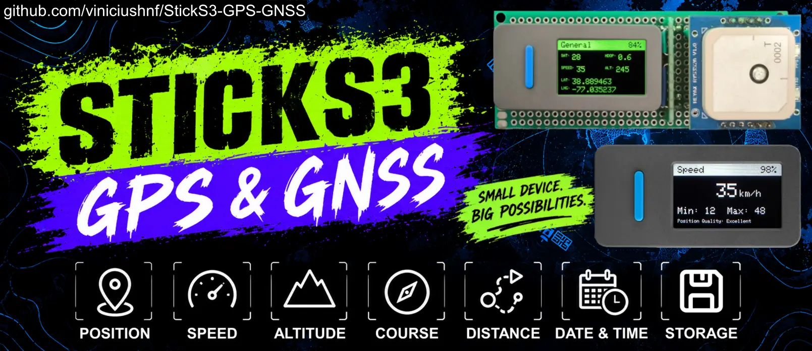
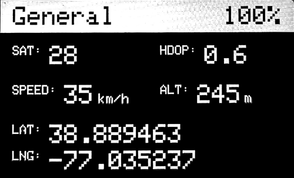
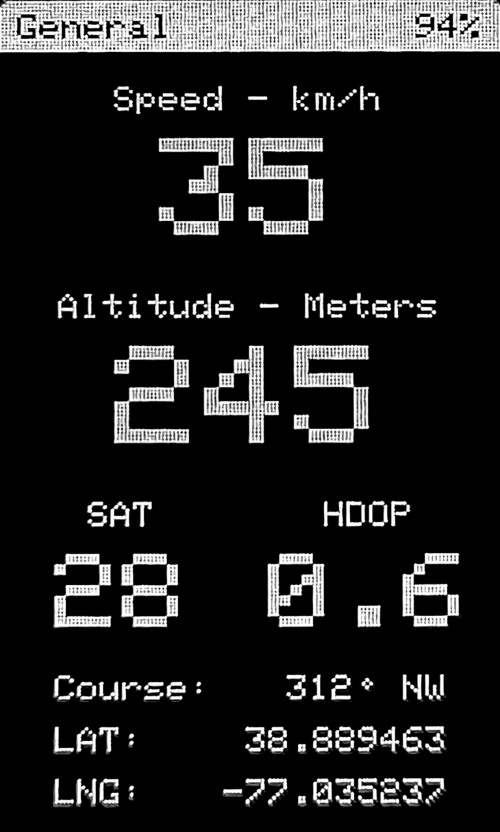
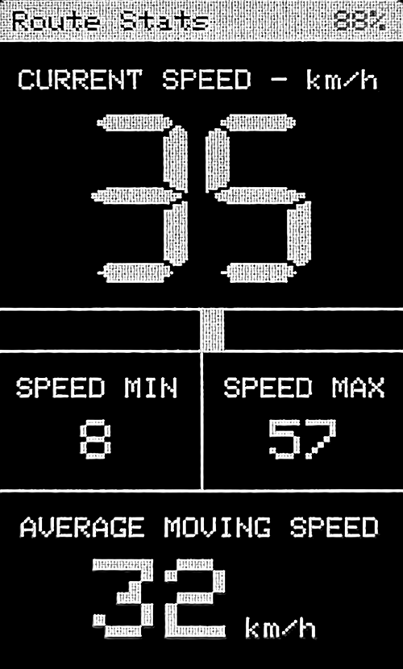
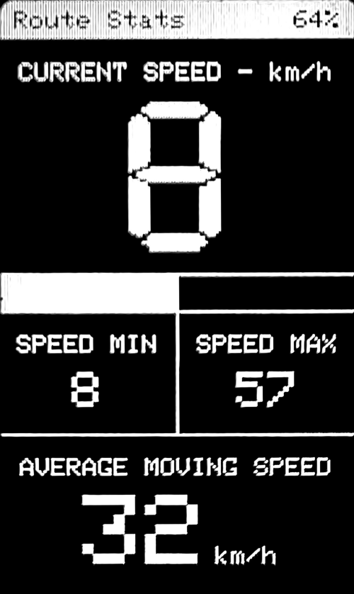
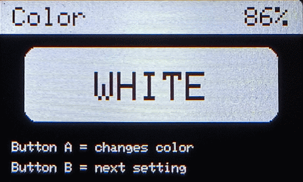
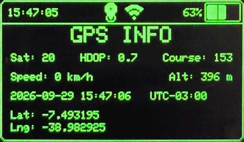
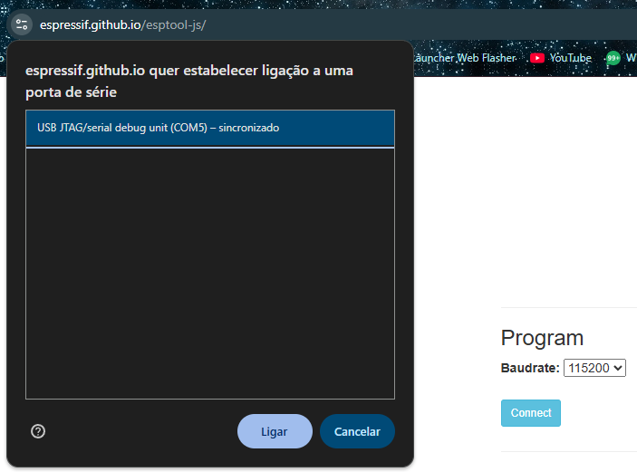

  

# StickS3 with GPS and GNSS

Turn your **M5StickS3** into a compact and practical GPS/GNSS device.

This project provides two firmware options for connecting a compatible GPS or GNSS module to the StickS3 and displaying positioning and satellite information directly on its screen.

The main goal is to make GPS/GNSS data easy to access in a portable device, whether for navigation, testing, field monitoring, development, or simply exploring positioning data.

## ✨ What This Project Provides

This repository includes:

* Compatible module requirements
* Instructions for connecting a GPS/GNSS module
* Hardware assembly information
* Configuration instructions
* Two firmware options for the StickS3
* Precompiled `.bin` firmware files
* Source code for **GPS & GNSS Monitor**
* Firmware installation instructions
* Basic usage instructions for both firmware options

The two firmware options are:

| Firmware               | Main Purpose                                                                                                                                                                                |
| ---------------------- | ------------------------------------------------------------------------------------------------------------------------------------------------------------------------------------------- |
| **GPS & GNSS Monitor** | Dedicated firmware for monitoring GPS/GNSS positioning, satellite, movement, distance, route, and time information                                                                          |
| **Bruce Modified**     | Bruce firmware with all its existing features, enhanced with a new **GPS Info** screen for viewing satellites, HDOP, course, speed, altitude, date, time, timezone, latitude, and longitude |

---

## 📡 GPS/GNSS Module Compatibility and Electrical Safety

### What makes a module compatible?

The firmware is designed for GPS/GNSS receivers that output standard **NMEA data over UART** and can be configured to use one of the supported baud rates. The firmware uses UART communication in `SERIAL_8N1` format: 8 data bits, no parity, and 1 stop bit.

A module is not guaranteed to work simply because it is described as a GPS or GNSS module. Before connecting one, check its documentation to confirm that it can output compatible NMEA data over UART, that its baud rate is supported, and that its voltage and logic levels are safe for the StickS3. Verify compatibility before testing an unfamiliar module.

The following are examples of GPS/GNSS modules that use UART and provide NMEA data: **RYS352A, NEO-6M, NEO-M8N, BN-220, ATGM336H, MAX-M10S, and M5Stack GPS modules**

> **⚠️ Important:** Before connecting a GPS/GNSS module to the StickS3, always check the module's datasheet and verify its **power supply voltage, UART logic levels, pinout, and communication settings**. Specifications may vary between manufacturers, module models, and breakout boards. Make sure that the module is electrically compatible with the StickS3 before connecting it.

### GPS versus GNSS

**GPS** is the satellite navigation system operated by the United States. **GNSS** is the broader term for Global Navigation Satellite Systems and can include GPS, Galileo, GLONASS, BeiDou, and other satellite constellations. A GNSS receiver that can use multiple constellations may be able to use more satellites in suitable conditions, but actual performance depends on the receiver, antenna, environment, and satellite visibility.

### Baud rates

The firmware offers these module baud rates:

`9600`, `19200`, `38400`, `57600`, `115200`

The selected rate must match the rate at which the module sends UART data. If the rates do not match, the StickS3 may receive unreadable data or no valid GPS/GNSS information. The baud rate selected in **Basic Settings** is the module communication rate; it is separate from the baud rate used by a computer when flashing the firmware.

### Voltage and UART logic-level safety

**Check voltage compatibility before connecting or powering the hardware.** The module's required supply voltage must be compatible with the voltage supplied by your chosen StickS3 connection (3.3 V or 5 V, depending on the connection and hardware specification). Do not assume that every module accepts either voltage.

Also check the module's UART signal levels, especially its **TX output**, which connects to the StickS3's RX input. The StickS3's GPIO logic is 3.3 V; the signal delivered to its GPIO must stay within the level supported by the StickS3. A module powered from 5 V may still output 5 V UART logic, which can damage the StickS3 if connected directly. Use a suitable level shifter or other properly designed interface if the module's TX signal is not 3.3 V-compatible.

Connect **GND to GND**, cross the UART signals correctly, and verify the module pinout before powering on:

- Module **TX → StickS3 RX**
- Module **RX ← StickS3 TX** (if the module requires receiving commands)
- Module **GND ↔ StickS3 GND**

The module's supply voltage and UART logic voltage are separate specifications; verify both in the module documentation.

### Accuracy and receiver quality

Different receivers, antennas, antenna placement, satellite visibility, signal strength, buildings, trees, reflections, atmospheric conditions, and other environmental factors can change fix acquisition time and the accuracy of position, speed, and altitude. The firmware displays and processes the information received from the receiver; it cannot create accuracy that the receiver's data does not provide.

For more reliable results, use a good-quality module and antenna, allow the receiver time to acquire a stable fix, and test in an environment with a clear view of the sky when possible.

### Recommended module: REYAX RYS352A

I used the **REYAX RYS352A** during development and testing and strongly recommend it based on my experience. In my tests, it provided excellent positioning quality and precision and acquired satellites quickly. Results can still vary with antenna placement, environment, and satellite conditions.

  

- **Official product page:** [reyax.com/product/GPS-GNSS/RYS352A](https://reyax.com/product/GPS-GNSS/RYS352A)
- **DigiKey:** [digikey.com/en/products/detail/reyax/RYS352A/22206992](https://www.digikey.com/en/products/detail/reyax/RYS352A/22206992)
- **eBay:** [ebay.com/itm/187031730034](https://www.ebay.com/itm/187031730034)
- **Amazon:** [amazon.com/dp/B0CM5JTJL7](https://www.amazon.com/dp/B0CM5JTJL7?lv=shuf&language=zh_TW&channelId=500&plpRedirect=mhFallback)

---

## 🔌 Wiring Diagram and UART Configuration

UART uses crossed signal connections: the module's TX sends data to the firmware's RX, and the firmware's TX connects to the module's RX if communication in that direction is needed.

### Recommended StickS3 connections

For the M5StickS3, these are the recommended pin assignments described for the respective connector:

#### Hat2-Bus
| StickS3 Pin | Configure as |
|---|---|
| **G44** | RX |
| **G43** | TX |

#### HY2.0-4P
| StickS3 Pin | Configure as |
|---|---|
| **G10** | RX |
| **G9** | TX |

> Remember that the pin configured as RX on the StickS3 must be connected to the TX pin of the module, and the pin configured as TX on the StickS3 must be connected to the RX pin of the module.

  

> Always verify the pinout of your specific module and the connection on the StickS3 before proceeding with the wiring. If the module only transmits NMEA data and does not require receiving commands, the connection from the StickS3’s TX pin to the module’s RX pin may not be necessary for basic monitoring.

---

## 📍 GPS & GNSS Monitor

The **GPS & GNSS Monitor** is a firmware designed to receive, process, and display real-time data from compatible GPS/GNSS modules through UART communication using the NMEA protocol.

Its main purpose is to provide a simple and intuitive interface for monitoring positioning information, including latitude, longitude, altitude, speed, course, satellites, and HDOP. It also offers trip and route statistics, allowing users to track distance, travel time, average speed, and other useful information.

The firmware provides several customization options, including communication settings, measurement units, coordinate formats, date and time formats, and display preferences. It is designed to be flexible and compatible with a wide range of GPS/GNSS modules that support standard NMEA output over UART.

For the complete documentation, detailed screen descriptions, configuration options, source code, and updates, visit the dedicated repository: **[github.com/viniciushnf/M5StickS3-GPS-GNSS-Monitor](https://github.com/viniciushnf/M5StickS3-GPS-GNSS-Monitor)**

### ➡️ Main Features 

- **Real-Time GPS/GNSS Monitoring:** Displays position, satellites, speed, altitude, course, date, and time.
- **Position Quality:** Displays satellite count, HDOP value, and positioning quality indication.
- **Trip Monitoring:** Tracks distance, total route distance, moving time, average speed, and minimum/maximum speed and altitude.
- **Multiple Screen Layouts:** Landscape and portrait layouts for General and Route Stats screens.
- **GPS/GNSS Session Information:** Displays information about the current monitoring session.

### ➡️ Settings and Customization

- **UART Configuration:** Configure the GPS/GNSS communication baud rate.
- **Measurement Units:** Customize speed, altitude, and distance units.
- **Coordinate Format:** Choose how geographical coordinates are displayed.
- **Date and Time:** Customize timezone, date format, and time format.
- **Display Settings:** Customize theme color, brightness, and automatic screen timeout.
- **Persistent Settings:** Configuration preferences are saved and retained after restarting the device.
- **Trip Reset:** Reset trip data and route statistics whenever needed.

### ➡️ Navigation

The GPS & GNSS Monitor uses two physical buttons to navigate between screens and access settings. The interface is designed to be simple and intuitive, allowing users to quickly access GPS/GNSS information and customize the firmware.

- **Button A - Short Press:** Performs the action associated with the current screen or confirms a selection.
- **Button B - Short Press:** Moves to the next screen or option.
- **Button B - Long Press:** Returns to the previous screen or option.

### ➡️ Main screens

  

  
  
  

| Screen | Description |
|---|---|
| **General** | An overview of GPS/GNSS status, including satellite information and Position Quality. It has one landscape view and three portrait views. |
| **Position** | Shows the current latitude and longitude using the selected coordinate format. |
| **Speed** | Shows the speed reported by the GPS/GNSS module, using the selected speed unit, and includes Position Quality. |
| **Altitude** | Shows the altitude reported by the module using meters or feet, and includes Position Quality. |
| **Distance** | Shows the straight-line distance between the trip starting position and the current position. This is not the accumulated distance along the route. |
| **Route Stats** | Shows accumulated route distance, average moving speed, minimum and maximum speed, and time in motion. It has one landscape view and two portrait views. |
| **Course** | Shows the direction of travel calculated from GPS/GNSS course data. Course is based on movement, not a magnetic compass. |
| **Time** | Shows the date and time received from the module, adjusted using the configured timezone. |
| **Session Info** | Shows Time in Motion, Trip Time, and Fix Time. |
| **About** | Shows firmware information, including the version, selected RX/TX GPIOs, and baud rate. Button A switches to a second view with developer information and the GitHub repository link. |
| **Settings** | Allows access to the settings screens. |

### ➡️ Settings screens

  

| Setting | Description |
|---|---|
| **Theme Color** | Selects the color used for interface elements, text, and indicators. |
| **Background Color** | Selects the display background color. |
| **Brightness** | Adjusts display brightness from 10% to 100%. |
| **Screen Timeout** | Sets how long the display waits without button interaction before turning off, or disables the timeout. |
| **Screen Flip H** | Rotates horizontal layouts by 180 degrees when enabled. |
| **Screen Flip V** | Rotates vertical layouts by 180 degrees when enabled. |
| **Screen Rotate** | Applies an additional 90-degree rotation. |
| **Coord. Format** | Selects Decimal, DMS, or DM coordinate formatting. |
| **Speed Unit** | Selects km/h, mph, knots, or m/s. |
| **Min. Trip Speed** | Sets the minimum reported speed used for trip distance and time-in-motion calculations. |
| **Altitude Unit** | Selects meters or feet. |
| **Distance Unit** | Selects Metric or Imperial distance display. |
| **Timezone** | Sets the UTC offset used to display local date and time. |
| **Date Format** | Selects YYYY-MM-DD, MM/DD/YYYY, or DD/MM/YYYY. |
| **Time Format** | Selects 24-hour or 12-hour time. |
| **Screen Update** | Selects automatic screen updates or a fixed refresh interval. |
| **Module Timeout** | Sets when the Communication Warning appears, or disables the warning. |
| **Basic Settings** | Displays and configures the UART RX GPIO, TX GPIO, and module baud rate. |
| **Reset Trip** | Resets trip-related timers, distances, and statistics. |
| **Exit** | Leaves Settings and returns to the General screen. |

### ➡️ Installing GPS & GNSS Monitor

There are three ways to install this firmware: **M5Burner**, a precompiled **`.bin` file**, or **Arduino IDE**.

#### Option 1 — M5Burner

M5Burner is the most convenient option if you do not want to download and flash the firmware file manually.

  

1. Press and hold the StickS3 **Power** button until the indicator LED starts blinking to enter programming mode.
2. Connect the StickS3 to your computer with a USB cable.
3. Open [M5Burner](https://burner.m5stack.com/) in Google Chrome.
4. Select **StickS3** and search for `GPS & GNSS Monitor`, or open the direct firmware page:[burner.m5stack.com/A8XVKK](https://burner.m5stack.com/A8XVKK).
5. Select the connected device/serial port when prompted and follow M5Burner's on-screen instructions.
6. Wait for the installation to complete, then restart the device if needed.

#### Option 2 — Flash the `.bin` File

This method uses [Espressif ESP Tool JS](https://espressif.github.io/esptool-js/).

1. Download `GPS_GNSS_Monitor.bin` from the [GPS & GNSS Monitor repository](https://github.com/viniciushnf/M5StickS3-GPS-GNSS-Monitor).
2. Press and hold the StickS3 **Power** button until the indicator LED starts blinking.
3. Connect the StickS3 to your computer with USB.
4. Open [ESP Tool JS](https://espressif.github.io/esptool-js/) in Google Chrome and select the device's serial/COM port.
5. Select `GPS_GNSS_Monitor.bin`.
6. Apply the following settings, then start flashing:

   | ESP Tool JS setting | Value |
   |---|---|
   | Baud rate | `115200` |
   | Flash address | `0x0` |
   | Flash mode | `dio` |
   | Flash frequency | `80m` |
   | Flash size | `8MB` |

7. Wait for flashing to complete and restart the StickS3.

#### Option 3 — Arduino IDE

Use Arduino IDE if you want to compile the source code yourself or modify the firmware.

Requirements:

- [Arduino IDE](https://www.arduino.cc/en/software)
- M5Stack board support for the **M5StickS3**
- `M5Unified` library
- `M5GFX` library
- `TinyGPSPlus` library

Steps:

1. Download the file [GPS_GNSS_Monitor.ino](https://github.com/viniciushnf/StickS3-GPS-GNSS/blob/main/GPS_GNSS_Monitor.ino).
2. Open `GPS_GNSS_Monitor.ino` in Arduino IDE.
3. Install the required libraries through Library Manager if needed.
4. Install the appropriate M5Stack board support and select **M5StickS3** as the board.
5. Connect the StickS3 to your computer, select its serial port, and upload the sketch.
6. Connect the GPS/GNSS module and configure the baud rate and UART GPIOs so they match the module and wiring.

For more details about the firmware and its installation methods, see the [GPS & GNSS Monitor repository](https://github.com/viniciushnf/M5StickS3-GPS-GNSS-Monitor).

---

## 🦈 Bruce Firmware — Modified Version

The **Bruce Modified** firmware is based on the original [Bruce Firmware](https://bruce.computer/). I modified it by adding a dedicated **GPS Info** interface for viewing data received from a connected GPS/GNSS module, while keeping Bruce's other features available.

### ➡️ GPS Info Screens and Features

The added GPS Info interface provides several views:

- **GPS Info:** satellites, HDOP, course, speed, altitude, date and time, timezone, latitude, and longitude.
- **GPS Speed:** current speed.
- **GPS Altitude:** current altitude.
- **GPS Time:** date and time received from the receiver.
- **GPS Position:** geographic coordinates.

  

While inside GPS Info, use **"Next"** to move to the next GPS screen and **"Previous"** to return to the previous screen. Use **"Select"** to open the menu.

The menu provides the following options:
- **Save Data:** Saves the current GPS/GNSS data.
- **Speed Unit:** Changes the speed measurement unit.
- **Altitude Unit:** Changes the altitude measurement unit.

When changing the speed or altitude unit, both the displayed unit and the corresponding value are automatically converted to the selected measurement unit.

Supported units include:

| Measurement | Available units |
|---|---|
| Speed | `km/h`, `mph`, `knots`, `m/s` |
| Altitude | `meters`, `feet` |

The displayed date and time are based on information from the GPS/GNSS receiver. The receiver provides UTC time, and the timezone configured in Bruce is applied to display local time.

### ➡️ Saving GPS/GNSS Data

The modified firmware can save GPS/GNSS information to **LittleFS** or an **SD card**, where supported by the device and firmware setup. When saving, you can specify a place/location name and a file name.

To find saved files, open the Bruce file explorer and navigate to the `BruceGPS_data` folder.

The saved text file can contain details such as:

- Place/location name, local date and time, and timezone.
- Satellites, HDOP, speed, altitude, and course.
- Coordinates in decimal degrees, degrees and decimal minutes, and degrees/minutes/seconds.
- UTC date/time and UTC time in ISO 8601 format.

### ➡️ Configuring the GPS/GNSS Module

In Bruce, open: `GPS → Config`

Set the **Baudrate** to match the baud rate configured on the connected module. Follow the pin recommendations to configure RX and TX according to the interface you are using (Hat2-Bus or HY2.0-4P).

  

### ➡️ Installing Bruce from a `.bin` File

The modified Bruce firmware is available as precompiled `.bin` files, based on different Bruce releases. Choose one of the following files to download and install:

- [`Bruce-v1.16.1.bin`](https://github.com/viniciushnf/StickS3-GPS-GNSS/blob/main/Bruce-v1.16.1.bin) — Based on Bruce firmware version **1.16.1**.
- [`Bruce-v1.17.bin`](https://github.com/viniciushnf/StickS3-GPS-GNSS/blob/main/Bruce-v1.17.bin) — Based on Bruce firmware version **1.17**.

The newer version, **Bruce v1.17**, includes additional features and bug fixes compared to v1.16.1. **I recommend using Bruce v1.17**, as it offers the latest improvements and fixes.

Download your preferred `.bin` file from the repository before starting. You can flash it using [Espressif ESP Tool JS](https://espressif.github.io/esptool-js/), a browser-based flashing tool. 

> **Google Chrome is recommended** because it supports the Web Serial features required by the tool.

#### 1. Put the StickS3 into programming mode

1. Press and hold the StickS3 **Power** button.
2. Keep holding it until the indicator LED starts blinking.
3. Connect the StickS3 to your computer with a USB cable.

#### 2. Flash the firmware

1. Open ESP Tool: [https://espressif.github.io/esptool-js/](https://espressif.github.io/esptool-js/).
2. Connect to the StickS3 and select its serial/COM port.
3. Select the firmware BIN file.
4. Use the settings below.
5. Start the flashing process and wait for it to finish.
6. Restart the StickS3 if it does not restart automatically.

| ESP Tool JS setting | Value |
|---|---|
| Baud rate | `115200` |
| Flash address | `0x0` |
| Flash mode | `dio` |
| Flash frequency | `80m` |
| Flash size | `8MB` |

  
  
  

> **Important:** Make sure you select the correct firmware file and follow the flashing settings above. Installing firmware replaces the firmware currently on the StickS3.

- **Official Bruce website:** [https://bruce.computer/](https://bruce.computer/)
- **Original Bruce source code:** [BruceDevices/firmware on GitHub](https://github.com/BruceDevices/firmware)

---

## 🚀 Installing Multiple Firmwares with M5Launcher

You can install both **GPS & GNSS Monitor** and **Bruce Modified** on the same StickS3 and switch between them whenever you want by using a firmware launcher.

For this, you can use **[Launcher Project (M5Launcher)](https://bmorcelli.github.io/Launcher/)**, which allows you to install and manage multiple firmware options on your device.

### ➡️ Installing M5Launcher

You can install M5Launcher using either of the following methods:

- **Official Web Installer:** [bmorcelli.github.io/Launcher/webflasher.html](https://bmorcelli.github.io/Launcher/webflasher.html)
- **M5Burner:** [burner.m5stack.com/H7PTFD](https://burner.m5stack.com/H7PTFD)

> Before starting the installation, put your StickS3 into programming mode by pressing and holding the Power button until the indicator LED starts blinking.

### ➡️ Installing Firmware Through the WUI

After installing M5Launcher, you can use its **WUI (Web User Interface)** to install both firmware options.

Follow these steps:

1. Connect your computer to the same Wi-Fi network as your StickS3.
2. Open the WUI using the IP address displayed on the M5Launcher screen.
3. Enter the `Username` and `Password` displayed on the StickS3 screen.
4. After logging in, navigate to **↑ OTA**.
5. Select the `.bin` firmware file you want to install.
6. Click **Start Update** to begin the installation.
7. Wait for the update process to finish, then restart your StickS3.

You can download the precompiled `.bin` files for both **GPS & GNSS Monitor** and **Bruce Modified** directly from this repository.

Repeat the same procedure to install the other firmware. Once both are installed, you can use M5Launcher to choose which firmware to start.

### ➡️ Installing GPS & GNSS Monitor from the Launcher App Store

You can also install **GPS & GNSS Monitor** directly from the M5Launcher firmware catalog, without manually downloading its `.bin` file.

1. Open **OTA** from the M5Launcher interface.
2. Browse the available firmware list or select **Refine Search**.
3. Search for `gps`.
4. Find **GPS & GNSS Monitor (viniciushnf)** in the results.
5. Select the firmware and follow the installation instructions.

After installation, GPS & GNSS Monitor will be available through M5Launcher.

This allows you to keep both firmware options installed on your StickS3 and easily switch between them whenever you need.

### ➡️ Switching Between Installed Firmwares

To switch between installed firmware options, simply press **Button A (the blue button on the StickS3)** while M5Launcher is starting up, right after turning on your device when the **"Launcher"** screen appears.

This will open the M5Launcher menu, where you can navigate through the available options and select the firmware you want to start.

---

# 👋 Get in touch

If you build this project, I'd love to see the result! 

If you have any questions, suggestions, or run into any issues, feel free to contact me on Instagram. 

I'm always happy to help, receive feedback, and see what the community creates. 

I'm also open to collaborations and partnership opportunities related to electronics, embedded systems, and open-source projects.

* Instagram: **@viniciushnf**
* [instagram.com/viniciushnf](https://www.instagram.com/viniciushnf/)

---

## ⭐ If You Find This Project Useful

If this project helps you turn your StickS3 into a practical GPS/GNSS device, consider giving the repository a ⭐ on GitHub.

Enjoy experimenting with GPS and GNSS!

---

# 🔗 Related Projects

### GPS & GNSS Monitor

For more detailed information about the dedicated GPS & GNSS Monitor firmware, including its source code, features, screens, configuration, and development details:

[GPS & GNSS Monitor — GitHub](https://github.com/viniciushnf/M5StickS3-GPS-GNSS-Monitor)

### Original Bruce Firmware

The modified Bruce firmware is based on the original Bruce project:

[Bruce Firmware — GitHub](https://github.com/BruceDevices/firmware)

---

# 📚 Useful Links

* [ESP Tool JS — Espressif](https://espressif.github.io/esptool-js/)
* [M5Stack StickS3 Documentation](https://docs.m5stack.com/en/core/StickS3)
* [M5Stack StickS3 Arduino Documentation](https://docs.m5stack.com/en/arduino/m5sticks3/program)
* [Bruce Firmware — GitHub](https://github.com/BruceDevices/firmware)
* [REYAX RYS352A — Official Product Page](https://reyax.com/product/GPS-GNSS/RYS352A)

---

# 🙏 Acknowledgments

Special thanks to **REYAX** for providing the **RYS352A GNSS module** used during the development and testing of this project.

Thank you for supporting the project and for providing a module that performed very well during testing.

---

# 📄 License

This repository contains multiple components with different licenses.

### GPS & GNSS Monitor

The dedicated **GPS & GNSS Monitor** firmware is distributed under the **MIT License**.

### Bruce Modified

The modified Bruce firmware is based on the original Bruce Firmware and is distributed according to the **GNU Affero General Public License v3.0 (AGPL-3.0)** and the applicable terms of the original project.

See the license information included with each firmware where applicable.

### Documentation

The documentation and original written content of this repository are provided under the license specified for the repository documentation.

Third-party software, libraries, firmware, trademarks, and other materials remain subject to their respective licenses and terms.